# 总论

本材质包的制作基于iris Labpbr最新规则，材质包风格以贴近原版为主，不对模组所提供的贴图进行颠覆性的更改，除非贴图设计在pbr效果中存在不合理的情况；

由于材质包风格贴近原版的特性，因此在_n和_s贴图制作过程中大多以贴图像素化的色块为基本单位进行处理，即模组中提供的16\*16像素的贴图中一个1\*1px色块为一个基本单位，但是由于本材质包为128分辨率的材质包，会对贴图分辨率以邻近（硬边缘）采样放大8倍进行处理，因此实际上是以8\*8px为基本单位，大部分蒙版的制作和像素的处理也基本遵循8\*8px最小单位。

# 如何使用designer节点生成基础的_n和_s贴图

首先需要在assets\"modname"\textures中获取模组提供的贴图类型，贴图分辨率一般为16\*16px，我们需要对png图片进行放大处理，长、宽像素分别放大8倍，例如16\*16px->128\*128px，64\*32px->512\*256px，但是注意图片放大采用邻近（硬边缘）采样，防止放大后出现模糊。

我们应当在Substance 3D Designer中新建Substance图形，并将图片放入该Substance图形的资源库文件夹中。

## _n贴图：Normal_X/Normal_Y/AO/Height

_n贴图R、G通道存储xy方向Normal信息，B通道存储AO信息，A通道存储Height信息。

原贴图首先进入一般流程：  
原贴图->Grayscale Conversion->Auto Levels

### Final _n RGBA Merge R,G

Auto Levels->Levels->Normal->RGBA Split

- 一般情况下，Levels节点的SPECIFIC PARAMETERS中Level Out Low=0.4，Level Out High=0.6
- Normal节点Intensity=3 Normal Format=OpenGL Alpha Channel Content=Force Alpha To 1

> Auto Levels节点作用在于归一化灰度图，方便后续各个Levels节点通过节点具体参数精确控制灰度范围

> Levels节点的输出范围设置为0.4-0.6的原因是将灰度图颜色范围控制在较窄的区域内，使得Normal节点生成的法线强度合理可控

RGBA Split节点的R、G通道分别接入各自的Pixel Processor，两个Pixel Processor的function如下：

R-Pixel Processor:

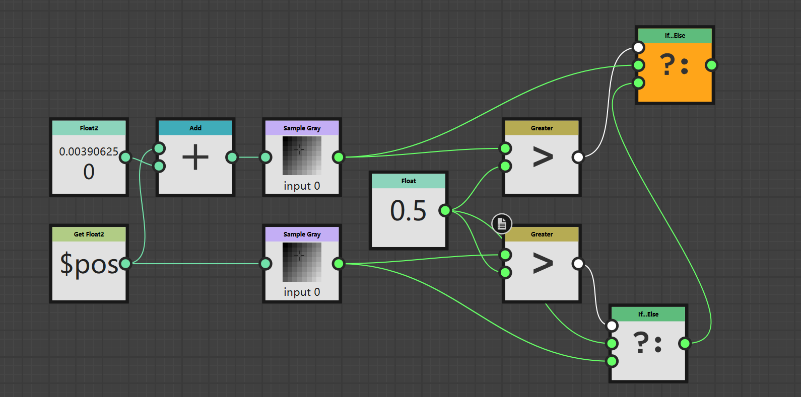

```
Get Float2($pos)->Sample Gray
Get Float2($pos) Add Float2(1/size,0)->Sample Gray*
if Sample Gray*>0.5:
    output=Sample Gray
else:
    if Sample Gray>0.5:
        output=0.5
    else:
        output=Sample Gray

#size是图片的分辨率，例如128*128px的图片size=128
```

G-Pixel Processor:

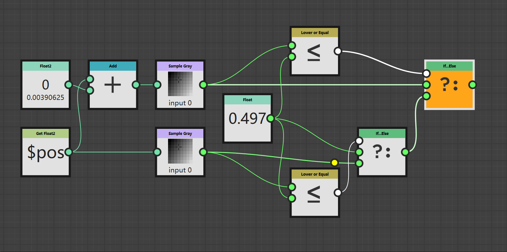

```
Get Float2($pos)->Sample Gray
Get Float2($pos) Add Float2(0,1/size)->Sample Gray*
if Sample Gray*<=0.498:
    output=Sample Gray
else:
    if Sample Gray<=0.498:
        output=0.5
    else:
        output=Sample Gray

#size是图片的分辨率，例如128*128px的图片size=128
```

接下来将重新处理过的Normal-R和Normal-G重新放入同一个RGBA Merge进行归一化。

- R-Pixel Processor->RGBA Merge-R
- G-Pixel Processor->Invert Grayscale->RGBA Merge-G
- Uniform color (*Grayscale,L=255*)->RGBA Merge-B,A
RGBA Merge->Normal normalize->RGBA Split->RGBA Merge R,G ***for final _n R,G use***

### Final _n RGBA Merge B

Auto Levels->levels(*Level Out Low=0.4,Level Out High=0.6*)->Ambient Occlusion(HBAO)->RGBA Merge B ***for final _n B use***

> Height Depth=0.03是128\*128px的图片中AO强度最为舒适的值，不同尺寸的图片应当采用不同的Height Depth值以获得相同的视觉环境光遮蔽强度，Height Depth应该是采用(1/size)^2的方式计算，即512\*512px的图片的Height Depth=0.0075（？？？）

### Final _n RGBA Merge A

Auto Levels->Levels(*Level Out Low=200/255,Level Out High=1*)->RGBA Merge A ***for final _n A use***

- 在目前大多数包含视差效果的着色器中，Level Out Low=200/255是视觉上能够接受的最低值，过于低的Level Out Low值容易产生视觉错误；
- 方块边缘处的灰度值在不等于1，即边缘不是满高的情况下，着色器会错误的将贴图另一侧的视差效果迭代显示出来，这会导致方块边缘出现参差和错误的视差效果，因此除非迫不得已，方块边缘的贴图的_n贴图A通道应当尽量为1，即边缘满高。
- 对于贴图中同一种材质的部分，我们希望他们的视差高度差异不要大，因此在Levels处理时，我们常常减小Levels in Mid值为0.3-0.4之间，使得同一种材质内部高度均匀
- 视差在着色器下的很多情况下表现并不美观，我们不希望贴图出现参差错落的不规则视差，而是希望有规则的、有逻辑地视差，在规则与逻辑之外的视差我们希望视差高度差异尽量减小

**上述三个部分的 ***for final _n use*** 产生的四张灰度图分别接入总的RGBA Merge节点的R,G,B,A通道，这张RGB贴图即为基本的_n贴图。**

## _s贴图：Smoothness/F0(Metalness)/Porosity and SSS/Emission

_s通道的处理相对自由，可以采用_n贴图处理过程中从Auto Levels接出Levels节点的方式进行灰度值的精确处理，对于较为简单的材质也可以采用直接设置Uniform Color节点的Grascale L值的方式处理。

### Final _s RGBA Merge R

Auto Levels->Levels->RGBA Merge R ***for final _s R use***

R通道的灰度图通常通过从Auto Levels接出Levels节点的方式进行处理，通过设置Level Out Low和Level Out High来控制材质的Smoothness。对于材质统一的贴图，通常Level Out High-Level Out Low<0.2，例如木板的Level Out Low和Level Out High分别为0.4，0.5，这通常是用于机器或者家具使用的木制，具备磨制或抛光的效果

- 通道灰度值=0.5(R=128)一般意味着材质具有一定的光滑程度但是又并不是强烈的反光效果；
- 锈蚀过的、较为粗糙的、没有打磨过的金属、不透光的毛玻璃一般采用R=190~220
- 较为光滑的金属，打磨光滑的玻璃R=240~255;
- 不具有反光效果的材质R采用0~50

> 由于经过Auto Levels节点再接入Levels贴图的各个像素之间的灰度值差异会非常大，即使缩小了Level Out Low和Level Out High的差值也会存在这个情况，通常我们可以通过减小Levels节点中的Level in Mid来进一步缩小各个像素之间的灰度值差异，例如Level in Mid=0.3~0.4通常可以获得一个较为接近Level Out High的均匀材质光滑度

### Final _s RGBA Merge G

Uniform Color->RGBA Merge G ***for final _s G use***

#### Labpbr金属预设

| G 值 | 金属类型 |
| ---: | --- |
| `0`   | 大部分非金属通用 |
| `230` | 铁 |
| `231` | 金 |
| `232` | 铝/玻璃 |
| `233` | 铬 |
| `234` | 铜 |
| `235` | 铅 |
| `236` | 铂 |
| `237` | 银 |

### Final _s RGBA Merge B

Uniform Color->RGBA Merge B ***for final _s B use***

0-64表示孔隙率，值越大吸水性越强，B=64在雨天下方块表面着色器表现为无雨滴涟漪贴图；65-255表示次表面散射率，越高的值材质对光条件下透光率越强；

### Final _s RGBA Merge A

Uniform Color->RGBA Merge A ***for final _s A use***

表示自发光强度，对于默认不发光的方块，**Uniform Color设置为255为最为稳妥的值**，对于极少数有发光需求的贴图，0-254发光强度递增，但是一般A=50-100已经是视觉上亮度极高的值，对于minecraft模组中硬编码发光强度<10的方块，最好采用A=20-30较为舒适。

**上述三个部分的 ***for final _n use*** 产生的四张灰度图分别接入总的RGBA Merge节点的R,G,B,A通道，这张RGB贴图即为基本的_n贴图。**

# 如何利用蒙版制作更精致的视觉效果

第一部分介绍的_n和_s贴图的制作是基于颜色所提供的明暗信息来生成Normal、Height等信息的。

对于以下这些情况，我们需要制作蒙版对由颜色生成的灰度图进行特殊处理：

- 同一张贴图存在差异巨大的材质，例如金属与非金属同时存在且有明显的分区；
- 贴图中有提供明显的几何信息，例如几个方块组成的突起，或者多处方块组成了有意义的裂缝、凹陷或者几何图案。比如原版砖块就存在明显的砖块凸起和砖块间的凹陷，原版木板也有明显的有规律的凸起和凹陷；*这些有规律的、整体化的而非像素化的效果需要通过综合分析原始贴图含义得出结论*；

## 金属蒙版的特殊处理方法

对于材质中的金属部分，首先需要识别出所有属于金属材质的像素块，然后生成一张与原图片尺寸完全相同的蒙版图片，图片除了金属部分的像素为白色，其他的像素块全部为黑色，并导入到Substance图形中的资源库中。接下来需要在原基本制作_n和_s流程的基础上进行进阶操作。

### _n R,G通道进阶处理

***以下部分为重点***

原流程：Auto Levels->Levels->Normal->RGBA Split

- Levels与RGBA Split之间插入：
->Blend(*Opacity~=1,Blending Mode=Add(Linear Dodge)*)->Blend(*Opacity=0.35,Blending Mode=Substract*)。*对于大部分贴图中的金属部分，应该是略高于其他部分的，因此法线应该遵守此规则，所以我们在Normal前提高了金属部分的灰度值，使得法线的生成符合梯度逻辑*  

> 应当注意的是，第二个Blend节点的Opacity~=0.5只是一个参考值，代表金属部分在高度上仅仅略高于其他部分，具体情况可以视灰度情况而定，目的就是达到让金属部分灰度值略高于它周围部分的灰度值
> 第一个Blend的作用在于，我们先让所有金属部分灰度值达到255，在第二个Blend减去时金属部分依然会保持同样的灰度值，原因是我们不希望金属部分各个8\*8px块之间存在法线，金属部分内部应该不存在法线而是一个统一的光滑的状态，仅仅在金属部分与非金属部分交界的位置产生法线

- 先对之前生成的金属蒙版黑白图片进行处理  
金属蒙版(Grayscale模式)->Non_uniform_blur_grayscale(input、blurmap同时接入金属蒙版)(*Intensity=5,其他presets使用默认预设*)->Normal(*Intensity=1.5,Normal Format=OpenGL,Alpha Channel Content=Force Alpha To 1*)->RGBA Split

RGBA Split R->Pixel Processor(令其为PP-R*)  
RGBA Split G->Pixel Processor->Invert Grayscale(令其为PP-G*)  
(*R、G的Pixel Processor分别使用前面使用过的同样的R-/G-Pixel Processor逻辑*)

- 在原R-Pixel Processor->RGBA Merge R之间插入Blend(*Opacity=1,Blending Mode=Overlay*)(PP-R*->Foreground,PP-G*->Background)，G通道同理在Invert Grayscale与RGBA Merge G之间插入Blend；

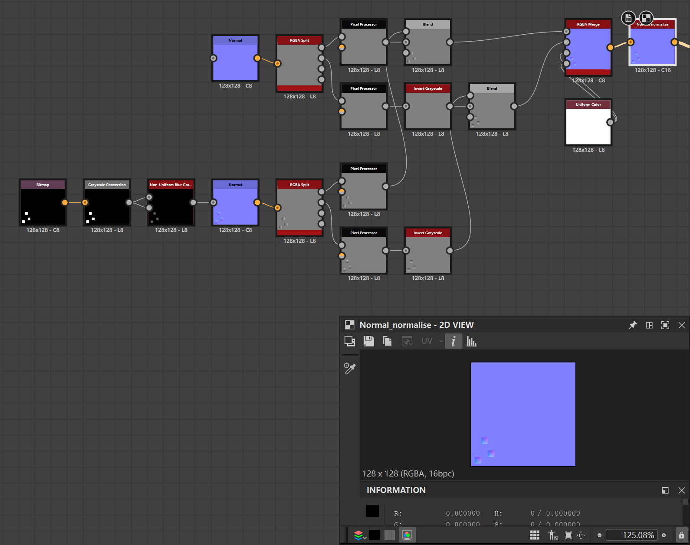

> 通过Non_uniform_blur_grayscale处理，对于金属与非金属之间生成柔和的渐变法线
> 应当注意的是，Non_uniform_blur_grayscale(*Intensity=5*)，Normal(*Intensity=1.5*)的Blur法线只是对于128\*128px适用的Blur参数，这样的Blur参数会在金属与非金属边缘处，在金属一侧生成宽度约4px的渐变法线；对于更大尺寸的贴图，往往需要采用更低的Intensity，例如1024\*1024px的贴图，Non_uniform_blur_grayscale(*Intensity=1.25*)，Normal(*Intensity=0.75*)是一个不错的参数组合，**可以注意到，Non_uniform_blur_grayscale的Intensity采用平方反比的规律，而Normal的Intensity采用反比规律**

### _n B通道进阶处理

同样需要在B通道的levels节点后面加入Blend(*Opacity~=0.1,Blending Mode=Add(Linear Dodge))(foreground=金属蒙版图片，background=Levels)

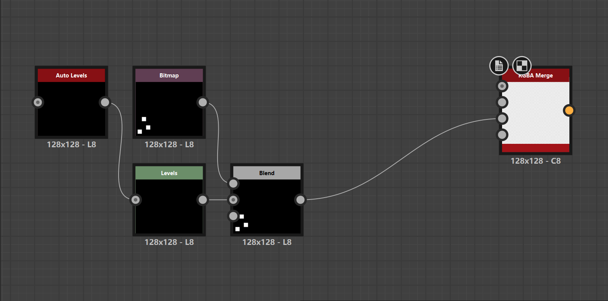

### _n A通道进阶处理

同样需要在A通道的levels节点后面加入Blend(*Opacity~=1,Blending Mode=Add(Linear Dodge)*)(foreground=金属蒙版图片，background=Levels)



> 需要注意的是，A通道在Add金属蒙版图片的时候，由于一般的金属部分的POM都略高于其他部分，因此采用填满A=255的方式。

### _s 各个通道进阶处理

对于金属部分，_s贴图大多数只有R,G通道需要处理，大多数都采用在按原始流程处理过后的节点后新添加Blend(*Opacity=\*\*,Blending Mode=Add(Linear Dodge)*)(foreground=金属蒙版图片，background=前一个节点),Opacity值取决于Add后金属部分的R,G值是否符合金属的目标值(例如旧金属R~=210,抛光金属R~=245-255,铁G=230,铜G=234)。

> 如果在Add过后金属部分的灰度值内部差异很大，可以采用Blend(*Opacity=1,Blending Mode=Add(Linear Dodge)*)->Blend(*Opacity=\*,Blending Mode=Substract*)的方式先统一灰度值，再减去保持统一

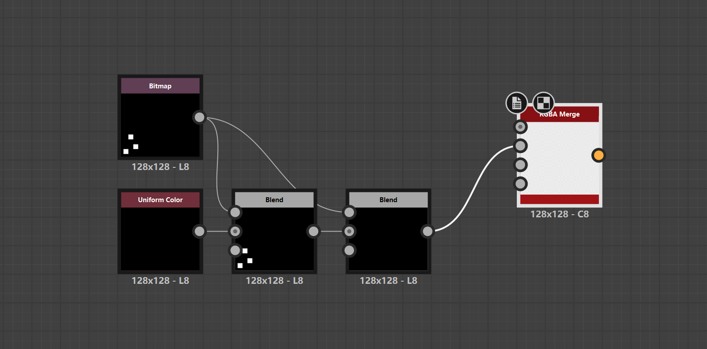

## 几何形状蒙版的特殊处理方法

几何形状与金属蒙版存在相似之处，我们一般都是要对于凸起或者凹陷的部分进行强化处理。

- 首先同样要生成凸起与凹陷部分的黑白蒙版，生成尺寸与原贴图相同的图片，凸起部分为白色，凹陷部分为黑色；另生成尺寸与原贴图相同的图片，凹陷部分为白色，凸起部分为黑色；例如对于一张木板图片：

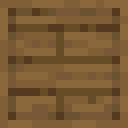

需要生成这两张蒙版图方便后续处理：

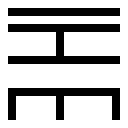
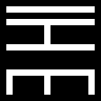

这两张图片分别用来统一提高凸起部分和统一降低凹陷部分，需要注意的是，**凸起部分和凹陷部分的判定一定要是规则的、有规律的，不要将单一8\*8px色块的灰度值偏低错误判定为凹陷，模组提供的原始贴图存在色块不合理的地方，请忽视这些部分，综合考量方块用途、实际规律、几何形状、美观整洁度来确定凹陷与凸起**。

- 其次要生成大块凸起的宽法线蒙版，即对于大块的凸起，例如一块24\*40px的几何凸起，我们要在原始1px宽度法线的基础上，在凸起边缘一圈建立8px宽度的宽法线使得视觉效果更柔和，例如对于上面的模板图片barrel_bottom.png，我们可以对于其凸起蒙版图生成这样的蒙版图：

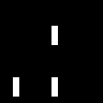
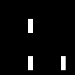
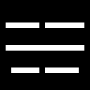
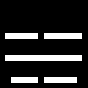

> 注意其生成逻辑实际上是与正常的法线生成逻辑基本类似的，可以总结为如下逻辑：将128\*128px图片视为16\*16px的图片，法线宽度占1px(实际对应上述8px宽度的宽法线)，法线根据灰度梯度生成于高灰度值的一侧

### _n 各通道处理方法

首先是对于_n各通道都要经过的Levels，我们需要在原始Levels的基础上，对于凸起和凹陷部分进行整合与强化，统一降低凹陷部分，统一增高凸起部分，***使得材质的大尺度形状更为明显***，这些目标都可以通过接入Blend节点选择Blending Mode为Add(Linear Dodge)或Substract的方式来强化大尺度形状变化

图例就通过添加Blend(*Add(Linear Dodge)*)强化了凸起部分的灰度值

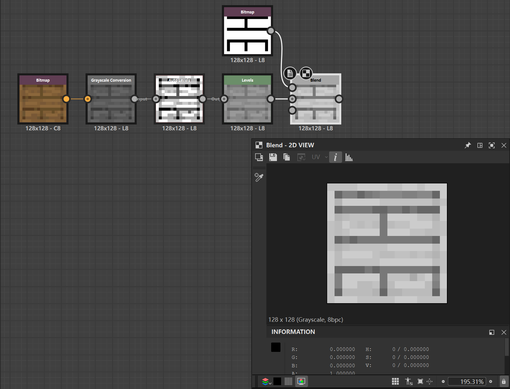

如果凸起部分的内部较为光滑，要求的内部视差很小，我们可以通过双Blend节点先Add后Substract的方法，减少甚至抵消内部灰度差，Blend(*Opacity=1,Blending Mode=Add(Linear Dodge)*)是抵消内部灰度差的极限值，一般情况可以使用Opacity<1的方法，使得内部一些灰度值高的部分先抵达255，灰度值低的部分还未抵达255，这样就会减少灰度值极差，然后再使用Blend(*Blending Mode=Substract*)线性减小到某个合适的区间内

#### _n R,G通道的特殊处理方法

在R-Pixel Processor分支后使用Blend添加宽法线

R-Pixel Processor->Blend(*Opacity=0.08-0.15,Blending Mode=Add(Linear Dodge)*)(foreground=\*\*_up_x_right.png,background=R-Pixel Processor)->Blend(*Opacity=0.08-0.15,Blending Mode=Substract*)(foreground=\*\*_up_x_left.png,background=R-Pixel Processor)

G-Pixel Processor->Blend(*Opacity=0.08-0.15,Blending Mode=Add(Linear Dodge)*)(foreground=\*\*_up_y_down.png,background=G-Pixel Processor)->Blend(*Opacity=0.08-0.15,Blending Mode=Substract*)(foreground=\*\*_up_y_on.png,background=R-Pixel Processor)

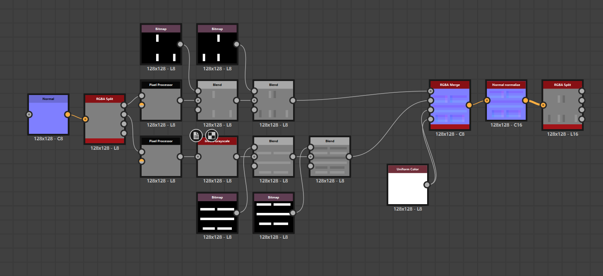

### _s 各通道处理方法

对于_s各通道的处理视材质情况而定，我们既然已经获得了凸起和凹陷部分的黑白蒙版图，自然可以通过Blend来独立处理各个部分的材质Roughness,Metalness,Porosity/SSS,Emissive,***应当注意的是，如果凸起/凹陷部分内部存在不同材质的情况，我们同样可以创建新的对应各个材质的黑白蒙版来独立处理各个材质的通道属性***

> 对于贴图中材质的分类，需要根据以下因素来判断区分：通过原贴图不同色系区分、通过模组提供的信息判断、通过mcmod等网站提供的方块材质信息判断

# 大尺度几何形状判断相关(*主要供机器学习与模型训练使用*)

对于贴图上较大尺度上的几何形状与几何意义判断，机器学习与模型训练判断往往存在难点，我们提供以下指引：

我们以如下1.21.1-Neoforge原本贴图为例：

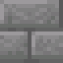

可以发现原版甚至模组中提供的许多bricks都存在固定的形状模式，我们以蒙版图的形式标明：

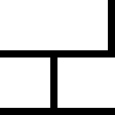

shape_mode_1.png中白色部分即为许多bricks通用的凸起部分形状模式，但是我们发现，这个凸起形状的判断并不能通过明确的明暗色值来区分，这是因为，*大部分原贴图为了表现方块在视觉效果上的立体感与光照方向感，会在凸起形状的部分绘制明暗渐变色值变化，以此产生受光与背光面，在背光面常常会被模型误判为凹陷部分*，

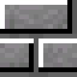

在上面这张图中白色与黑色部分标明了凸起部分的强受光面与强背光面

ai在判断大尺度凹陷与凸起的几何形状时需要考虑到这一点

# How To Mask Material More Real?

对于类似纸张、羊毛这种视差与法线均不明显的材质，我们往往可以使用真实纹理通过Blend为模组提供的原始像素贴图添加更加真实的效果，例如下图是一张gpt_image_2自动生成的羊毛纹理，我们可以通过本文第一部分讲述的法线R/G分量提取模块(Normal->RGBA Split->Pixel Processor R/G(->Invert Grascale))与原贴图的R/G通道法线进行Blend(一般采用Blending Mode=Overlay)

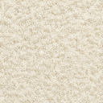

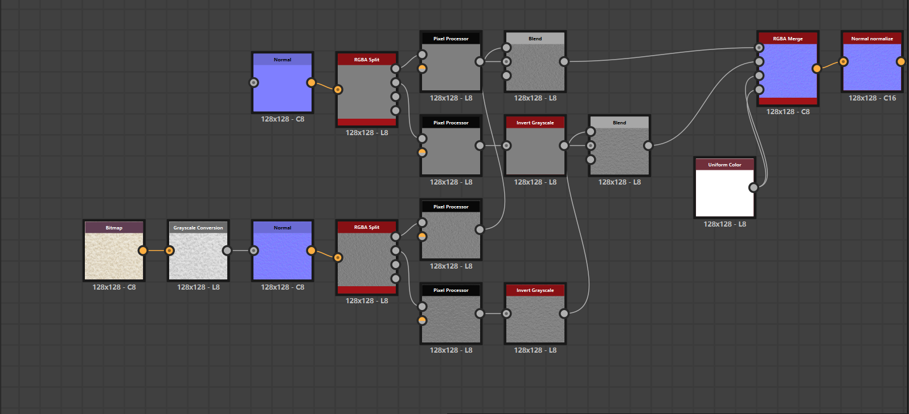

此方法可以为低视差、低法线材质提供更为真实的纹理感

# 非正常尺寸贴图与箱型uv贴图处理相关(*主要供机器学习与模型训练使用*)

许多模组中存在一张贴图通过mcmeta文件实现动画效果，或者将同一个方块的不同状态、不同面使用的贴图同时排布在同一张大的贴图中，它们通常将几张不同的贴图以并列的方式排布在同一张大贴图中，我们需要首先按同样的邻近放大方式放大这些非常规尺寸的贴图，uv的排布与判断依据模组assets/*mod_name*/model/block或assets/*mod_name*/model/item文件夹中模型的uv排布裁切方式，ai需要以模型uv使用方式来裁切箱型uv的各个部分为多张128\*128px贴图进行独立的处理。

# Summary

本文介绍了使用Substance 3D Designer中创建Substance图形操控节点形成工作流的方式来半自动化生成PBR贴图，codex需要以此为纲领，在sbs提供的Python API接口中，读取、修改、创建 Substance graph，批量改节点、批量组合材质，*蒙版的制作、几何形状的判断、材质的属性判断在不确定的情况下需要向用户求助*。









